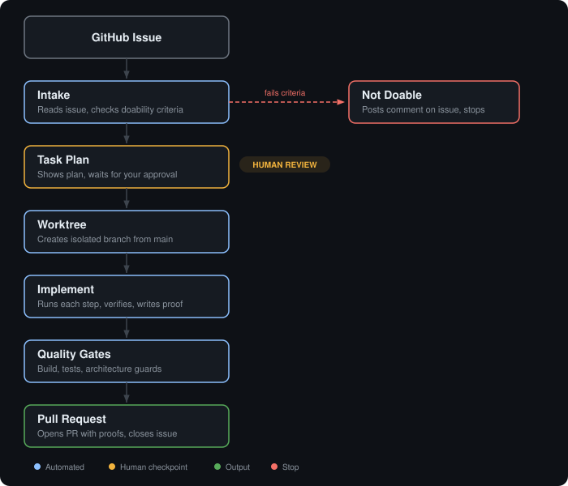

<div align="center">


# Ratly

**Real-time API rate limiting dashboard with live admin controls**

[](https://github.com/t-tornado/ratly/actions/workflows/server.yml)
[](https://github.com/t-tornado/ratly/actions/workflows/ui.yml)
[](https://github.com/t-tornado/ratly/actions/workflows/core.yml)

</div>

---

Ratly is an API rate limiting service with a real-time admin dashboard. Each user gets a configurable request budget per hour (default 100). When they run out, they get a 429 with a retry time. Admins see everything live and can step in — reset a window, raise a limit, grant extra requests, or pause enforcement. Updates reach every connected dashboard within a second over WebSocket.

## Demo

<!-- TODO: Add assets and uncomment -->
<!--  -->
<!-- [Watch the demo video](docs/assets/demo.mp4) -->
<!-- [Storybook components](docs/assets/demo-storybook.png) -->
<!-- [Ratis in action](docs/assets/demo-ratis.mp4) -->

## Prerequisites

| Tool | Version | Used for |
| --- | --- | --- |
| [Docker](https://docs.docker.com/get-docker/) | 20+ | Running Redis (required for all modes) and the full stack |
| [Node.js](https://nodejs.org/) | 22+ | Local development and local testing mode |
| [pnpm](https://pnpm.io/) | 9+ | Package management and workspace scripts |

Docker is the only requirement for the default setup. Node.js and pnpm are needed if you want to run the apps locally for development or as a fallback when Docker networking causes issues.

## Getting started

The entire stack runs in Docker. Clone the repo and bring it up:

```bash
git clone https://github.com/t-tornado/ratly.git
cd ratly
docker compose up -d
```

This starts the server, the UI, and Redis. Open [localhost](http://localhost) to see the dashboard.

At this point the dashboard is empty because no one is making API requests yet. You have two options:

**Monitor mode** — just the dashboard, waiting for traffic. This is what you get with the command above. Point your own API clients at `localhost:3000` with an `x-user-id` header and watch the dashboard populate as requests flow in.

**Load mode** — the dashboard plus a built-in load generator that simulates 2,000 users at different speeds, from heavy consumers who exhaust their limit in minutes to light users who trickle in over half an hour:

```bash
docker compose --profile load up -d
```

The dashboard starts filling within seconds. You can watch users approach their limits, see 429s start firing, and use the admin controls to intervene.

To stop everything:

```bash
docker compose down
```

## Architecture

Ratly is a monorepo with three apps and one shared package. Each app is independently deployable and scoped to a single responsibility.


The **server** handles rate limiting and admin operations. Each rate-limit check is atomic — concurrent requests from the same user can never race past the limit. After each request, the server pushes an update to all connected dashboards over WebSocket.

The **UI** is a React dashboard that shows a live table of all users with their current usage, status, and reset time. Clicking a user opens a detail view with activity charts and admin controls.

The **shared package** (`@ratly/core`) holds types and constants used by both the server and UI. Zero runtime dependencies.

The **load app** generates realistic API traffic so you can exercise the full system without external tooling.

> Detailed architecture decisions and trade-offs: [docs/decisions/](docs/decisions/)

## How it works

### Rate limiting

Each user is identified by an `x-user-id` header on their API requests. When a user makes their first request, a one-hour window starts. Every subsequent request decrements their remaining budget. When the budget hits zero, the server returns 429 until the window expires and a fresh budget starts.

This state is ephemeral by design — there is no historical database. When a window expires, it's gone. A rate limiter protects capacity, not billing records. Losing state just means users temporarily get extra capacity, which is the safe failure mode.

### Admin controls

From the dashboard, admins can intervene on any user:

- **Reset** — wipe the current window so the user starts fresh immediately
- **Adjust limit** — change a user's hourly budget (up or down, takes effect on the next request)
- **Add extra requests** — grant bonus requests within the current window only
- **Pause** — temporarily stop enforcing the limit (requests are still counted but never rejected)
- **Resume** — end a pause early

Every admin action takes effect instantly and pushes an update to all connected dashboards.

### Real-time updates

The server pushes three types of events over WebSocket: individual user updates after each request, limit-exceeded notifications, and dashboard-wide stats every 10 seconds. The UI subscribes on connect and gets a full snapshot, then applies events as they arrive.

> System design docs: [docs/01-redis-data-model.md](docs/01-redis-data-model.md) · [docs/02-admin-actions.md](docs/02-admin-actions.md) · [docs/03-flows-and-scripts.md](docs/03-flows-and-scripts.md)

## Design decisions

Every significant decision is documented with context, alternatives considered, and trade-offs. Redis is the only data store because the state is ephemeral. There is no database because there is no persistence requirement. Each choice has a recorded rationale and a clear trigger for when to revisit it.

> [docs/decisions/](docs/decisions/)

## AI-Powered Development


Ratly uses 14 Claude Code skills to automate structured development tasks — from triaging a GitHub issue to shipping a pull request with passing quality gates. Every skill follows the same coding rules as human contributors, and every action produces a verifiable artifact: proof files for each implementation step, gate reports for each PR. Nothing is committed without evidence that it works.

### Ratis — autonomous issue agent

Ratis is the centerpiece of this system. Give it a GitHub issue number, and it ships a complete pull request — reading the issue, planning the implementation, writing the code, running the tests, and opening the PR with proof of every step attached.



**Intake** — Ratis reads the issue and checks whether it's scoped, verifiable by tests, fully contained in the codebase, and away from security-critical code. If any check fails, it posts a comment explaining why and stops.

**Task plan** — If the issue passes, Ratis builds a step-by-step plan where each step has a verify command. This is the one human checkpoint — you review and approve before any code is written.

**Worktree** — Ratis creates an isolated branch from main in a separate worktree. Your working directory is never touched. If anything fails, the branch is deleted with no side effects.

**Implement** — Each step runs in order, gets verified, and produces a proof file. If any verification fails, Ratis stops and shows you the exact output.

**Quality gates** — After all steps pass, Ratis runs build, tests, and architecture guards for every affected app. If everything is green, it opens a PR with the proofs embedded and a `Closes #N` reference.

### Templates and rules

Issues follow a [template](docs/agentic-playbook/templates/ratis-issue.md) that separates what to change from how to verify it. All skills load the project's [rule files](.claude/rules/) fresh each run — the same standards enforced in CI are enforced during AI-assisted development.

> Full documentation: [docs/agentic-playbook/](docs/agentic-playbook/README.md) · [Skills reference](docs/agentic-playbook/skills.md) · [Issue writing guide](docs/agentic-playbook/writing-issues.md)

## Development tools

| Tool | Command | What it does |
| --- | --- | --- |
| **Storybook** | `pnpm --filter @ratly/ui storybook` | Browse all 23 design system components in isolation |
| **Load testing** | `docker compose --profile load up` | Simulate 2,000 users across 4 traffic profiles |
| **Guard tests** | `pnpm --filter @ratly/ui test:guards` | Enforce architecture rules at test time |
| **Visual compare** | `/visual-compare` in Claude Code | Screenshot diff between prototype and implementation |
| **Code review** | `/code-review` in Claude Code | Review local changes against main for rule violations |

## Code quality

All code follows 8 rule files that enforce naming conventions, type safety, import structure, JSDoc commenting standards, component architecture, hook separation, server module patterns, and branch naming. These rules are enforced in three ways: agent skills read and follow them, guard tests verify them at test time, and CI pipelines check them on every push and pull request.

> Rule files: [.claude/rules/](.claude/rules/) · CI workflows: [.github/workflows/](.github/workflows/)

---

## Stack

| Layer | Technology |
| --- | --- |
| Frontend | React 19, Vite, Tailwind CSS v4, Recharts, TanStack Virtual |
| Backend | NestJS, Fastify, Socket.IO |
| Storage | Redis 7 (Lua scripts for atomic operations) |
| Shared types | `@ratly/core` (zero runtime dependencies) |
| Testing | Vitest, Playwright (e2e), custom architecture guards |
| CI | GitHub Actions (scoped per app, path-filtered) |
| Design system | 23 components, dark-first, IBM Plex Sans + Mono, Storybook |
| Load testing | Custom Node.js scenarios, Dockerized |
| AI tooling | 14 Claude Code skills, Ratis autonomous agent |

## Testing

The test suite covers unit tests, integration tests with a real Redis instance, end-to-end tests, and architecture guard tests.

| Suite | Command | Prerequisites |
| --- | --- | --- |
| Server unit tests | `pnpm --filter @ratly/server test` | None |
| Server integration tests | `pnpm --filter @ratly/server test:integration` | Redis on port 6380 |
| Server e2e tests | `pnpm --filter @ratly/server test:e2e` | Redis on port 6380 |
| UI unit tests | `pnpm --filter @ratly/ui vitest run --project unit` | None |
| UI guard tests | `pnpm --filter @ratly/ui test:guards` | None |

To start the test Redis instance:

```bash
docker compose up redis-test -d
```

## Local development

If you want to work on the code without Docker, you need Node.js 22+, pnpm 9+, and a running Redis instance.

```bash
# Install all dependencies
pnpm install

# In one terminal — start the backend
pnpm dev:server    # runs on port 3000

# In another terminal — start the frontend
pnpm dev:ui        # runs on port 5173, proxies API to :3000
```

The UI dev server proxies API requests to the backend, so you don't need to configure CORS or URLs.

### Local testing mode

If Docker gives you trouble (network conflicts, healthcheck issues, or platform-specific problems), you can run the full stack locally with a single command. Only Redis runs in Docker — the server, UI, and load generator run natively:

```bash
pnpm install
pnpm dev:full
```

This starts Redis via Docker Compose, then launches the server, UI, and load generator (steady scenario with 2,000 users) in order. The server starts first and the script waits for its health endpoint before starting the rest. Ctrl+C stops everything.

## Project structure

```
ratly/
  apps/
    server/            NestJS backend — rate limiting, admin API, WebSocket gateway
    ui/                React dashboard — live table, user detail, admin controls
    load/              Load test scenarios — steady (2k users), burst, mixed
  packages/
    core/              Shared types + constants (zero dependencies)
  docs/
    decisions/         Architecture and technical decision records
    agentic-playbook/  Agent system documentation
  .claude/
    rules/             Coding and structure rules
    skills/            Claude Code skill definitions
  .github/
    workflows/         CI pipelines — server, UI, core, asset cleanup
```

## Backlog

Some features were intentionally deferred — not because they were forgotten, but because they aren't needed for the current scope. Each one has a clear trigger for when it should be picked up.

> [docs/backlog.md](docs/backlog.md)

## License

MIT
